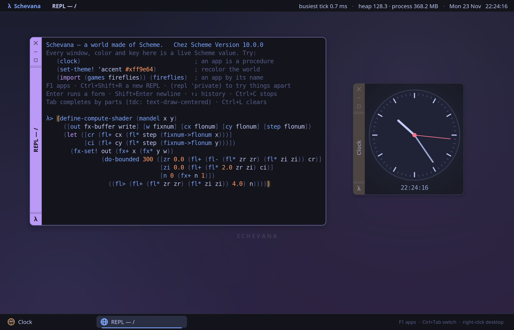

# Schevana



A Lisp Machine-style desktop that lives inside one window and is written
entirely in Chez Scheme. Every window, color, key binding, status-bar segment,
running process and GPU shader is a live Scheme value (shaders are written in
Scheme too, and compiled for the GPU as they're defined). You can inspect it,
redefine it and break it from a REPL that runs inside the world it changes.

The only C code involved is SDL3 (the window, input and the GPU),
FreeType and fontconfig (fonts), all called through Chez's FFI. There is no
build step: the first start compiles Schevana's libraries into the tree's
`.cache/`, and later starts load them from there. A `(reload!)` evaluates
again only the libraries whose files changed, with those that import
them, and loads the world's plain files (yours among them) again.

## Running

Schevana needs Chez Scheme 10, SDL 3.2 or later, FreeType, fontconfig, and
Vulkan on Linux or Metal on a Mac.

On Debian 13 (it should work on Ubuntu 26.04 or later too, although I
haven't tried):

```bash
sudo apt install chezscheme libsdl3-0 mesa-vulkan-drivers
```

On a Mac:

```bash
brew install chezscheme sdl3 freetype fontconfig
```

Then, with no build step:

```bash
./desktop
```

The options, the files it reads and writes, and the details for each
platform are in [docs/INSTALL.md](docs/INSTALL.md).

| Key | Action |
| --- | --- |
| F1 / click "λ Schevana" / right-click desktop | launcher (type to filter; in the GNOME style, F1 and the bars open the app grid); apps picked after a right-click open where you clicked |
| Ctrl+Tab | cycle windows |
| Ctrl+Shift+W / M / N / T / R | close / maximize / minimize / tile / new REPL |
| F11 | full screen on and off (also in the launcher) |
| F12 | screenshot to `~/schevana-N.png` |
| drag title, edges, corner; double-click title | move, resize, maximize |
| right-click title or taskbar button | window menu (incl. "Bind to `$w`") |

## Two editions

The same libraries run in one of two editions:

- The **library edition**, the default, loads Schevana's libraries
  compiled into `.cache/`, so the world loads quickly (about 0.2 s here),
  and it keeps each library's internals to itself: an app sees what the
  core's facade and the kits export. It is the edition for writing apps.
- The **hacker edition** (`./desktop --hacker`) splices every library
  into "/" from its source at each start, so it loads more slowly (about
  1.7 s), but it exposes every name, internals included, to see and
  redefine live: the full redefinability Schevana had before v2. Its heap
  is slightly smaller too (89 MB live after a collection, against 97 MB).

## The REPL

Ctrl+Shift+R or `(repl)` opens one. Enter evaluates a complete form, and
Shift+Enter adds a line; Up and Down move through the history, Tab
completes, and Ctrl+C stops what's running. What you type runs as a
Schevana process (backed by a Chez engine), so the desktop keeps running
meanwhile.

Every example in [docs/](docs/) works as written on a desktop started
with the demos (`./desktop demo`). Copy it from your browser or editor
and paste it into a REPL with Ctrl+V, which reads the system clipboard;
take a page's examples in the order the page gives them. A test runs
them all, each page in such a world (`tests/units/docs.ss`). A REPL's
text is selected with the mouse, and Ctrl+Shift+C copies it (Ctrl+C
stops what runs); a right click offers Copy and Paste. The kinds of REPL,
and what a `define` does in each, are in [docs/REPL.md](docs/REPL.md).

## The guide

A programmer's guide, with examples to try at the REPL, in reading order:

- [Installing and running](docs/INSTALL.md): what it needs, its options,
  the files it keeps
- [The REPL](docs/REPL.md): the world as data, redefining it, the kinds
  of REPL, libraries
- [Windows, apps and events](docs/WINDOWS.md): handlers, properties,
  frames, keys, timers, processes
- [Drawing](docs/DRAWING.md): shapes, text, clips, gradients, pixels
- [Widgets](docs/UI.md): the kit every app here is built with
- [The look](docs/LOOKS.md): settings, styles, parts, palettes,
  wallpapers
- [Your own apps](docs/APPS.md): keeping what you make, folders that
  load with the world
- [Shaders](docs/SHADERS.md): Scheme on the GPU
- [Environments](docs/ENVIRONMENTS.md): the tree of namespaces, sandboxes
- [Threads](docs/THREADS.md): worklets, the crew, vats
- [Monitoring](docs/MONITORING.md): Monitor, the Pipeline, the profiler,
  the Debug REPL
- [Internals](docs/INTERNALS.md): the boot chain, frames, the pacer
- [Testing](docs/TESTING.md): running the suites; writing tests is in
  [tests/GUIDE.md](tests/GUIDE.md)
- [Platforms](docs/PLATFORMS.md): what has run where;
  [NVIDIA on Linux](docs/LINUX_NVIDIA_TUNING.md)

## Tests

```bash
mkdir -p out
scheme --script tests/smoke.ss out
scheme --script tests/units.ss out
scheme --script tests/frame.ss out
scheme --script tests/sources.ss
SCHEVANA_HACKER=1 scheme --script tests/smoke.ss out
SCHEVANA_HACKER=1 scheme --script tests/units.ss out
```

In the hacker edition the units' runner runs only the topics that tell
the two editions apart. What each suite covers, how to run one check,
how to write a test, and the bench are in [tests/GUIDE.md](tests/GUIDE.md).

## Conventions

- Every line of every source file is at most 80 characters;
  `tests/sources.ss` checks it.
- American spelling: color, gray, center.

## Credits

What Schevana takes from others, and under which terms, is in
[CREDITS.md](CREDITS.md).

## Known gaps, and after v2

- There's no text editor app yet.
- Windows and their state are lost on exit: only the look is kept.
- It runs on Linux and on a Mac; I haven't tried Windows yet.

After v2, I plan to make the profiler profile memory properly. It now
sees how long the collector ran and how much was allocated in all, but
not what allocates, by window, process and procedure, or what each
collection costs.
